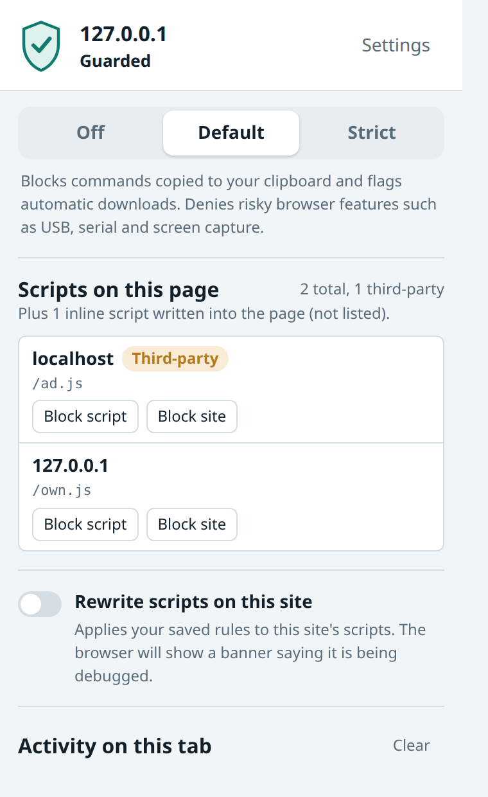
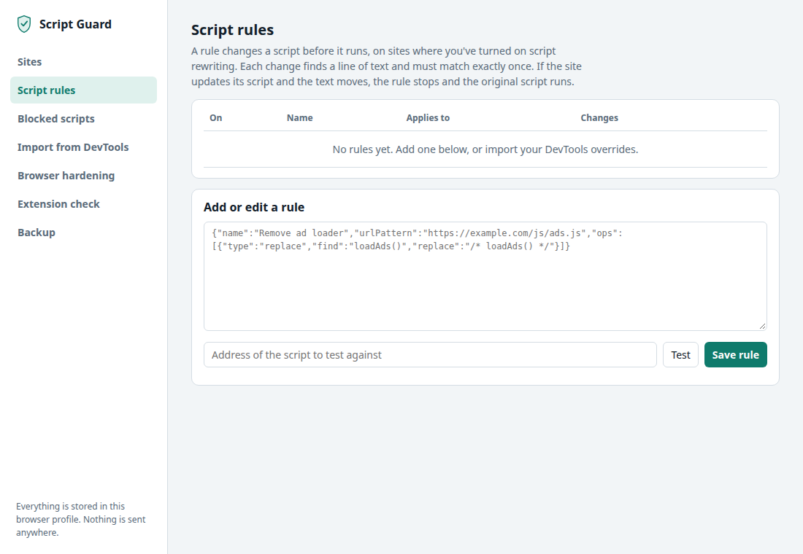

<p align="center">
  
</p>

<h1 align="center">Script Guard</h1>

<p align="center">
  A Manifest V3 extension for Brave and other Chromium browsers that limits what web pages can do with JavaScript,<br>
  and lets you fix a misbehaving site once and keep the fix.
</p>

<p align="center">
  <strong>No telemetry. No accounts. No remote code. Everything stays in your browser.</strong>
</p>

<p align="center">
  
  &nbsp;&nbsp;
  
</p>

> **Status: early release (0.1.0).** It is tested automatically against a real Brave build and is being manually tested on desktop. Expect rough edges and please report them. See [What it cannot do](#what-it-cannot-do) before relying on it.

## Features

| Protection | How it works | Applies in |
|---|---|---|
| **Clipboard guard** (the "fake CAPTCHA" / ClickFix trick) | Wraps the clipboard APIs in the page before page code runs and refuses writes that look like `powershell`, `mshta`, `curl … \| sh` and similar. Shows a notice and a toolbar badge. | Default, Strict |
| **Download guard** | Flags downloads a page starts without a click, and risky file types. | Default flags, Strict blocks |
| **Permissions hardening** | Adds a `Permissions-Policy` header that denies USB, HID, serial, MIDI, payment, screen capture and other powerful features. | Default, Strict |
| **Known-bad hosts** | Network rules block script hosts known to be compromised (`polyfill.io`, `bootcss.com`). The list ships inside the extension. | All except Off |
| **Script list and blocking** | The popup lists every script a page loads, third-party first, with one-click **Block script** and **Block site**. | All pages |
| **Script rewriting** (opt-in per site) | Applies your saved patch rules to a script's text before the page runs it. Uses the browser's debugger interface, so Brave shows its own banner while it is on. | Only sites you enable |

Each site has a profile: **Off** (nothing is injected into that site at all), **Default**, or **Strict**.

## Install

Script Guard is not in the Chrome Web Store. Load it as an unpacked extension.

1. Clone or download this repository.
2. Open `brave://extensions` (or `chrome://extensions`) and turn on **Developer mode**.
3. Choose **Load unpacked** and select the repository folder (the one containing `manifest.json`).
4. Pin the extension from the puzzle-piece menu so the shield is always visible.

After changing the code, press the reload icon on the extension's card, then reload the tab you are testing.

The install prompt mentions the **debugger** permission. It is declared up front because Chromium does not allow it as an optional permission, but nothing attaches to a page unless you switch **Rewrite scripts on this site** on for that site.

## Usage

- **Toolbar popup:** shows the current site, its protection level, the scripts it loaded and what was blocked. Change the level with the three-way control, then reload the tab.
- **Settings** (popup → Settings): per-site profiles, script rules, import from DevTools, blocked scripts, a browser hardening checklist, an audit of your other extensions, and backup and restore.
- **Incognito:** turn on **Allow in Private** for the extension in `brave://extensions`. Settings are shared between normal and private windows.

### Fix a site with malicious ads, once

1. In DevTools, open **Sources → Overrides**, pick a folder, and edit the offending script until the page behaves.
2. In Script Guard settings, open **Import from DevTools** and choose that overrides folder. For each saved file, the extension fetches the live original, works out the difference and offers it as a rule. Check the URL shown for each file and correct it if needed.
3. Save the rule, turn on **Rewrite scripts on this site**, and reload.
4. The popup's **Rewrites on this tab** panel shows which scripts were changed.

Rules match on text, not line numbers, and each anchor must match exactly once. If the site later changes its script so a rule no longer matches, the original runs unchanged and the popup shows the rule as stale. Nothing breaks silently.

To only stop a script from loading, use **Block script** in the popup. That needs no debugger.

### Hiding the debugging banner

The banner Brave shows while rewriting is on belongs to the browser and an extension cannot hide it. Launching the browser with `--silent-debugger-extension-api` hides it, but it hides it for every extension, so only do that in a dedicated test profile.

## What it cannot do

- **It does not stop attacks on the browser itself** (bugs in the JavaScript engine, graphics stack and so on). Keep your browser updated and site isolation on. Settings → Browser hardening has a checklist.
- **The page hooks are best-effort.** A page can sometimes reach unhooked copies of browser functions, for example through a `javascript:` iframe or a worker. Hooks do not run inside workers.
- **It cannot change response bodies without the debugger.** That is a Manifest V3 limit, which is why script rewriting is opt-in per site.
- **Direct `eval` is not hooked on purpose.** Wrapping it breaks real sites.
- **The known-bad host list is short.** Entries under `candidates` in `data/badhosts.json` are not blocked until verified.
- **A page can hide the in-page notice** with its own CSS. The toolbar badge and popup still record the block.

How these limits were measured is in [docs/feasibility-notes.md](docs/feasibility-notes.md).

## Privacy

Script Guard sends nothing anywhere. There is no analytics, crash reporting, update ping or remote list, and no remote code. The only network requests it makes itself are the ones you ask for: fetching a live script when you test or import a rule. Settings, rules and activity stay in local browser storage.

`test/unit/privacy.test.js` fails the build if code adds a beacon, XHR, remote script or an unreviewed `fetch()`.

Rules and blocks you save for a site persist on disk, including for sites you visit in a private window. Remove them in Settings if that matters to you.

## Development

Requires Node 20 or newer. There is no build step.

```sh
npm install
npm test                  # unit tests, no browser needed
node test/e2e/real.mjs    # loads the real extension in headless Brave and checks it end to end
node test/e2e/run.mjs     # content-script tests with a stub background
node test/e2e/debugger.mjs
node tools/make-icons.mjs # regenerate the icons in icons/
npm run package           # build dist/script-guard-<version>.zip
```

The end-to-end tests expect Brave at `/usr/bin/brave-browser`; set `BRAVE=/path/to/brave` to use another binary.

```
manifest.json
src/background/   service worker: header rules, downloads, events, blocks, debugger tier
src/content/      page hooks (main world), relay, script collector, in-page notice
src/shared/       pure logic with unit tests: schema, sites, scoring, patch engine
src/ui/           popup and settings pages
data/             bundled known-bad host list
test/unit/        node:test unit tests
test/pages/       adversarial test pages
test/e2e/         browser-driven tests
docs/             architecture and feasibility notes
```

Module interfaces and the event pipeline are described in [docs/architecture.md](docs/architecture.md).

### Releasing

1. Update `CHANGELOG.md` and set the same `version` in `manifest.json` and `package.json`.
2. Run `npm test`, `node test/e2e/real.mjs` and `npm run package`. The package script refuses to build if the two versions differ or if tests, docs or key files would be included.
3. Tag and push: `git tag -a vX.Y.Z -m "vX.Y.Z" && git push origin vX.Y.Z`.
4. On GitHub, draft a release from that tag, attach the zip, paste the changelog entry, and tick **Set as a pre-release** while it is still being tested.

Install a release by unzipping it and using **Load unpacked** on the unzipped folder. Unpacked extensions do not auto-update.

### A note on the test pages

`test/pages/` contains deliberately malicious-looking strings (for example a fake `mshta` command) used to test the clipboard guard. They point at `.test` domains and do nothing, but some antivirus tools may flag them.

## Contributing

Issues and pull requests are welcome. Please run `npm test` and `node test/e2e/real.mjs` before sending a change, and see `.claude/skills/mv3-review/SKILL.md` for the review checklist used for this project.

## License

[MIT](LICENSE)
